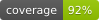

<div align="center">


</div>

### Build status




### Tools

[](https://github.com/python/mypy)
[](https://github.com/pytest-dev/pytest)
[](https://github.com/astral-sh/ruff)
[](https://github.com/sphinx-doc/sphinx)

---

_Dymoval_ is a Python package for exploring measurement data and checking how
well your models match the real world.

## Why dymoval?

Simulation lets you try ideas before taking them to the real system, where
testing can be expensive, time-consuming, or risky. But what if a good idea
looks bad just because the model is missing something?

Comparing your model with real measurements helps you understand where you
can trust it. Plotting the outputs together is a useful start, but a close
match is only part of the story: did the inputs exercise the system enough,
and do the errors show patterns?

## What is it?

Dymoval helps you check your models without having to build your own
analysis tools. Feed your model the inputs recorded during an experiment,
then use dymoval to compare its outputs with the measured ones.

Your model can come from Simulink, Modelica, Python, or another tool.
Dymoval only needs the signals, not the model itself.

<div align="center"
	<br>
	<br>

	<br>
	<br>
	<br>
</div>

There is another challenge before you can even compare the results:
real-world logs can be messy. One sensor records faster than another,
some samples are missing, and noise makes it hard to see what is going on.
Dymoval helps you get these signals ready to work with, without having to
write the same cleanup code for every experiment.

Once the data is ready, you can compare simulations, check fit scores, and
look for patterns in the errors. You can also estimate frequency responses
directly from measurements to explore how your system behaves.

Work in a notebook, inspect plots interactively, or run the same checks
automatically when your model changes, including in Jenkins or GitHub Actions.

## What it is not

Dymoval does not build or tune a parametric model for you, or run that
model's simulations. Keep using the tools you like for those tasks, then
bring the results to dymoval.

Matching one experiment does not mean a model will work everywhere.
You decide which experiments and checks matter for your application.

Dymoval supports **guided model assessment, not automatic certification**.
You do not need to implement the statistics yourself, but interpreting the
results still requires knowledge of your experiment and intended use.
**PASS means the configured checks passed on this dataset**, not that the
model is correct everywhere. FAIL is a reason to investigate, not an
automatic rejection; the default tolerances are starting settings.

For automated acceptance, calibrate and freeze the criteria, assess
representative independent records, and verify that the gate detects known
inadequate models. Require all expected results and retain the evidence.
See the [CI/CD guidance](https://ubaldot.github.io/dymoval/getting_started.html#model-ci-cd)
for coverage, error limits, reproducibility, and failure handling.

## Installation

Dymoval exists on both `pip` and `conda`, so you can choose between the
following:

```
pip install dymoval
conda install conda-forge::dymoval
```

> **Upgrading from 0.9?** Release 1.0 dropped the `pandas` dependency and
> rewrote the core, so it is **not** backwards compatible. See the
> [migration guide](https://ubaldot.github.io/dymoval/migrating.html) and
> the [changelog](CHANGELOG.md).

## Getting started

Have measured inputs `u_meas`, measured outputs `y_meas`, and simulated
outputs `y_sim` generated using those same inputs? If the signals are aligned
and share a sampling period, you can start with:

```
import dymoval as dmv

vs = dmv.validate_models(
    measured_in=u_meas,
    measured_out=y_meas,
    simulated_out=y_sim,
    sampling_period=sampling_period,
)
```

Displaying the returned object gives you something like the following
(illustrative values):

```
Validation results:
-------------------
Thresholds:
Ruu_correlation: 0.6000
r2: 35.0000
Ree_envelope: 1.0000
Rue_correlation: 0.5000

Actuals:
                                                        Sim_0
Input auto-correlation (abs_mean-max)                   0.3532
R-squared fit (%)                                     65.9009
Residual RMSE (max)                                   25.1090
Residual auto-correlation (Gaussian envelope ratio)     0.8000
Residual cross-correlation (abs_mean-max)                   N/A
Input-residual cross-correlation (abs_mean-max)         0.2053

Correlation scores: lower means less correlation.
R-squared fit: higher is better.
Residual RMSE: lower is better; output units/scaling must be comparable.
Input auto-correlation describes excitation, not model quality.

         Sim_0
Outcome: PASS
```

The results pass the selected thresholds for this experiment.

Residual RMSE is available alongside R-squared in
`vs.validation_statistics`; it has no default acceptance threshold.
Use `rmse_statistic="max"` (default) or `"mean"` to aggregate outputs with
comparable units/scaling.

Gaussian diagonal residual limits are enabled by default:
`Ree_envelope="auto"` uses `(0.95, 0.1, 5*Ts)` as starting settings.
Review these tolerances for your experiment; the width is not inferred from
the system dynamics. Use `Ree_envelope=None` for ordinary diagonal scoring.
For application-specific diagonal residual auto-correlation limits, pass
`Ree_envelope=(0.95, 0.1, 5.0)` to `validate_models` or `ValidationSession`.
These illustrative Gaussian parameters are the short-delay limit,
long-delay floor, and time scale in dataset time units—not universal defaults.
You can instead provide a dictionary of tuples keyed by output name.
`vs.plot_residuals()` shades the allowed region on the residual diagonal.
The separate `Ree_envelope` statistic is the worst violation ratio and
passes at or below 1 by default, replacing the ordinary diagonal check.
`Ree_correlation` always describes diagonal residual auto-correlations;
`Ree_cross_correlation` separately describes off-diagonal pairs. The report
shows the Gaussian ratio on the auto-correlation row when enabled, otherwise
the ordinary diagonal score. For one output, residual cross-correlation is
N/A and omitted from statistics and thresholds.

Correlation lags always use one-sample spacing. Choose a meaningful lag
window and keep it fixed across comparisons; extending it can dilute
`abs_mean`. No automatic bandwidth-based lag adjustment is performed.
Custom threshold dictionaries check only the listed keys; explicitly include
`"Ree_envelope": 1.0` to retain that check.

But what if the test didn't pass? Don't worry, it might not be the model's
fault.

For example, you could be dealing with noisy measurements, over-sampled
signals, drifting sensors, and other factors that might affect the results.
Take a look at the tutorial to learn how to address such issues:

```
  import dymoval as dmv
  dmv.open_tutorial()
```

These commands copy the tutorial files into a `dymoval_tutorial` folder in
your home directory. Open `dymoval_tutorial.ipynb` with Jupyter to follow
along.

And if you want to discover more on model validation and _Dymoval_ check out
the [docs](https://ubaldot.github.io/dymoval/).

## Main Features

**Working with measurements**

* Explore signals in time and frequency
* Estimate frequency responses with `Dataset.spa()`
* Filter noise, align sampling times, fill gaps, and remove offsets or trends
* See which values your measurements cover with histograms and statistics
* Keep track of signal names and physical units
* Click on plotted curves to inspect them with interactive scopes

**Checking your models**

* Compare several simulations against the same measurements
* Measure the fit with R-squared scores
* Look for patterns in errors using residual correlation checks
* Set your own thresholds for pass/fail checks
* Work with one or several inputs and outputs (SISO and MIMO)
* Run the same checks automatically when your model changes

## License

_Dymoval_ is licensed under
[BSD 3](https://github.com/ubaldot/dymoval/blob/main/LICENSE) license.
