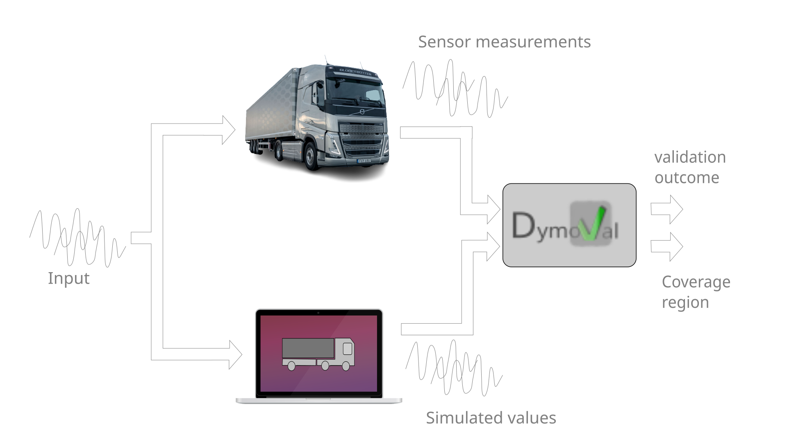

.. _model_validation:

###########################
 What is Model Validation?
###########################

Testing ideas on a real system can be expensive, slow, or risky. A simulation
lets you try them out first, but what if an inaccurate model makes a good idea
look bad?

Model validation checks how well a model describes the real system for
the tasks you want to use it for. Feed both the same inputs, then compare
their outputs using experimental measurements.

A common approach is to plot the measured and simulated outputs together:
if the curves overlap nicely, the model looks good. That is a useful first
check, but matching curves is not enough. Even a high fit score can hide
important shortcomings. For example, an experiment with little input
variation may never challenge the model's dynamic behavior.

We also need to assess the *input signals*: did they exercise the dynamics
and operating conditions we care about? Then we inspect the *residuals*,
the differences between measured and simulated outputs. Do they show
repeated patterns, or are they correlated with the inputs? Such patterns can
point to behavior the model has missed, although noise and measurement
problems can contribute too.

These checks complement each other: output comparisons show how closely
the predictions match, input assessment helps judge whether the experiment
was informative, and residual analysis helps reveal what the fit score
leaves out. That is why dymoval combines them rather than relying on a
single number or a convincing-looking plot.

The aim is not to prove that the model is perfect, but to understand where
you can trust its predictions and where more investigation is needed.

Dymoval makes these checks accessible without requiring you to implement
the statistics yourself. It is a tool for **guided model assessment**, not
an automatic certificate of correctness. Its default tolerances are starting
settings: interpreting the results requires knowledge of the experiment
and the model's intended use. A PASS means the configured checks passed
on the evaluated data; a FAIL calls for investigation.
For automated acceptance, see :ref:`model_ci_cd` for guidance on calibrating
criteria, checking coverage, and handling incomplete runs.

The model validation process happens in four steps:

#. **Design a Set of Experiments**: Define a set of experiments to be carried
   out on the target environment. This involves specifying the set of stimuli
   (*input*) to be applied on the target environment. Such a task is also
   known as the :ref:`doe`.

#. **Execute** the experiments planned in step 1. on the target environment
   and **collect** the response. The combination of the input signals and the
   system response is referred to as the *measurement dataset* (or simply
   dataset). Since sensors may be noisy, may be sampled at different rates or
   may log intermittently, you will most likely need to :ref:`clean up your
   measurements dataset <create_dataset>`.

#. **Generate Simulation Data**: Conduct the exact same experiments defined in
   step 1 on the model and :ref:`log its response <simulate_model>` and
   collect its response. Such a response is referred to as the simulation
   results.

#. **Evaluate the Results**: :ref:`Assess <validation_session>` how "close"
   the simulation results from step 3. are to the logged responses from step
   2. using specific validation metrics.

   The model validation process.  In this picture the validation method only
   returns a pass/fail value but in general it returns the evaluation of some
   model quality metrics.

Good results from step 4. provide evidence for using the model within the
evaluated region and for the intended task. They do not guarantee accuracy
under untested conditions or for other uses.

Let's see how steps 1-4 can be applied.

   **Example**

   Assume that you are developing some cool autonomous driving algorithm that
   shall be deployed in a car, which represent your *target environment*.

   Assume that your car model consider the following signals:

   #. *accelerator pedal position*,
   #. *steering wheel position* and
   #. *road profile*,

   as **inputs**, and the following signals:

   #. *longitudinal speed* and
   #. *lateral speed*.

   as **outputs**.

   Next, you want to validate your model.

   Steps 1-4 are carried out in the following way:

   #. **Design of Experiment (DoE)**: Choose a driving route with sufficient
      road slope variation. Plan to take a ride on that path with a
      challenging driving style, including sudden accelerations and abrupt
      steering movements. Congratulations! You have just created a Design of
      Experiment (DoE).

   #. **Data Collection:** Take a ride according to the plan. Log the input
      signals (i.e., the accelerator pedal position, the steering wheel
      position, and the road profile time-series) along with the output
      signals (i.e., longitudinal and lateral speed time-series) of the
      vehicle while driving. These logs represent your measurements dataset.
      Note how input and output are separated.

   #. **Model Simulation:** Feed your model with the input signals from the
      measurements dataset and log your model's output corresponding to the
      longitudinal and lateral vehicle speed dynamics, for which you also have
      the measurements data.

   #. **Comparison and Validation:** Compare the longitudinal and lateral
      vehicle speed time-series logged during the actual drive with the
      simulated results using specific validation metrics.

   You haven' finished yet. In-fact, when you develop and validate a model,
   you should also consider the coverage region of the model along with the
   validation results.

   If you logged data only in the *accelerator pedal position* range [0,40] %,
   the *steering angle* in the range [-2,2]° and the *road profile was flat*
   for all the time, then you have to deliver such an information along with
   your model to a potential model user.

The cost savings when using models are clear, but there is no free lunch. In
fact, the challenge lies in the design of good models.

.. toctree::
   :hidden:

   ./model_validation_index/doe
   ./model_validation_index/create_dataset
   ./model_validation_index/simulate_model
   ./model_validation_index/validation_session
